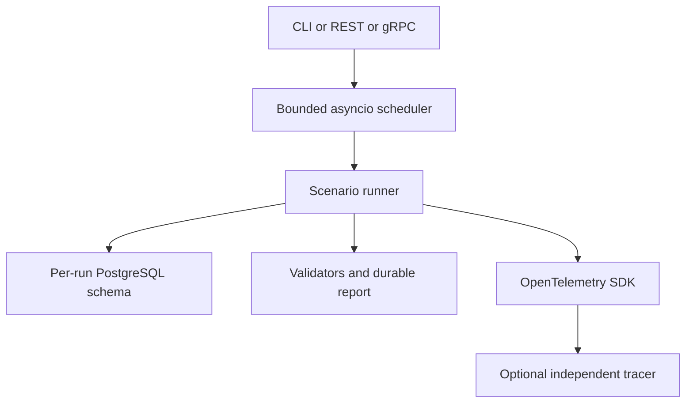

# Architecture and operating boundaries

## Lifecycle

1. Validate the complete scenario and persist its redacted specification with a unique run ID.
2. Enforce queue capacity and a worker semaphore. Carry the W3C context into the scheduled task.
3. Create a server-generated schema, tables, users, and knowledge documents.
4. Execute scripted transitions or bounded LLM turns. Mutations use receipts: replay returns the original response; reuse with different arguments fails.
5. Check step expectations and final ticket count/status. Record full synthetic final state, transcript, specification digest and elapsed time.
6. Close the connection, drop the run schema, and persist the report. Reports outlive their worlds.

## Failure semantics

- Injected lost response after ticket creation: retry the exact idempotency key; no duplicate mutation.
- Agent assertion failure: `failed`, harness_completed=true.
- Invalid tool request, timeout or unexpected exception: `error`, harness_completed=false.
- Cancellation: cancel the task, close/drop its schema, and persist `cancelled`.
- REST process restart: prior queued/running jobs are marked interrupted and schemas cleaned. No background distributed recovery, leader election, or automatic paid-call replay.
- The gRPC entry point is intended for isolated development sessions and does not implement restart reconciliation.

## Determinism

Scripted inputs, baseline fixtures and generated ticket IDs are reproducible. External model responses are not. Recorded actions are represented directly in the scripted fixture; there is no claim that setting a seed reproduces provider behavior. The fixture lookup `$last.id` refers only to the immediately preceding tool result.

## Security and privacy

Synthetic fixtures only. Schema identifiers are generated from validated UUID hex values; SQL values use parameters. Ports bind to loopback in Compose. These are not per-tenant database credentials or a hardened container sandbox. Live model access is explicitly opt-in and user-configured. Redaction handles emails and structured secret keys, including serialized JSON arguments; it does not detect all PII. Exception payloads are not exported automatically. Raw real prompts should not be used without an appropriate data policy and stronger controls.

## Implementation scope

This project implements a Python service and Go benchmark client. It does not claim a Go production service, Airflow deployment, 600-scenario benchmark, 85 vendor endpoints, sub-200ms teardown, or prior use by engineering teams. Runtime measurements are local and recorded separately. The optional live LLM adapter has stubbed contract tests; paid-provider validation is not included. Docker definitions are included; local verification used Python processes and real PostgreSQL rather than a Docker daemon.

## Source references

- https://opentelemetry.io/docs/languages/python/instrumentation/
- https://opentelemetry.io/docs/languages/python/propagation/
- https://www.postgresql.org/docs/current/ddl-schemas.html
